# ConceptStudio

**Teach an image or video model something new from your own photos or clips: a person, a pet,
an object, a style or a movement. Everything runs from a Mac, with no graphics card and no
machine-learning background needed.**

ConceptStudio is a native macOS app that turns a folder of examples into a trained
[LoRA](https://huggingface.co/docs/diffusers/training/lora), a small adapter that teaches a
diffusion model one new concept. It walks you through choosing examples, writing and reviewing
training captions, renting a GPU computer, training, and collecting the result. The Mac runs
the project; training runs on a GPU computer the app rents from [RunPod](https://www.runpod.io)
and controls for you, within the spending limits you set.

| Review captions beside the training images | Follow training as it runs |
| --- | --- |
|  |  |

<sub>Screens from the built-in offline demo, which uses synthetic photos and rents nothing.</sub>

> **Status: development preview.** The full workflow has run end to end in a signed, notarised
> build, from renting the computer to the trained adapter arriving on Hugging Face. There is no
> public download yet: build from source as shown below. [Current status](app/docs/APP-STATUS.md)
> lists what has been verified and what has not.

## How it works

Nine steps, each one a screen in the app's sidebar:

| Step | What happens |
| --- | --- |
| **Images** | Import photos or clips. Spot duplicates, include or exclude examples, and approve crops or exact video segments. |
| **Concepts** | Say what the adapter should learn, and choose the *trigger*: the word that names it in captions. |
| **Mapping** | Confirm which subject in each image the concept belongs to. Style and motion concepts apply to the whole image and skip this. |
| **Captioning** | A language model of your choice describes each example. A second model can review the captions. |
| **Review** | Edit captions beside the actual training media, and mark finished ones so later model runs leave them alone. |
| **Publish** | Package the approved media and captions as a Hugging Face dataset, or prepare them for direct upload. |
| **GPU pods** | Pick hardware and storage, see the hourly price, and set a budget and an idle limit before renting. |
| **Training** | Start a run from the model's tested recipe, adjust it, or repeat a saved run's settings. |
| **Monitor** | Watch the learning curve and training log, retrieve the adapter, and compare the base and trained models on the same prompts and seeds. |

Captions name the concept with its trigger and describe everything visible *outside* it:
clothing, setting, light, pose. That boundary tells training what belongs to the concept and
what doesn't. It guides learning but can't force it, so the choice of examples still matters.

## Supported models

Each model has a tested recipe, with its training length, learning rate, adapter size, image
sizes and checkpoint schedule chosen for that model:

| Model | Trains on | Notes |
| --- | --- | --- |
| [FLUX.1-dev](https://huggingface.co/black-forest-labs/FLUX.1-dev) | images | Non-commercial licence |
| [Z-Image](https://huggingface.co/Tongyi-MAI/Z-Image) | images | Apache 2.0; adapters also work on Z-Image-Turbo |
| [Qwen-Image-2.1](https://huggingface.co/Qwen/Qwen-Image-2.1) | images | Regularisation and REPA on by default; 80 GB GPUs |
| [LTX-2.3](https://huggingface.co/Lightricks/LTX-2.3) | images and video | Lightricks' own trainer |
| [LTX-2.5](https://huggingface.co/Lightricks/LTX-2.5) | images and video | Lightricks' own trainer; accept the licence on the Hub first |
| [MiniMax H3](https://huggingface.co/Comfy-Org/MiniMax-H3) | images and video | Native recipe with guidance controls |

Turn on **Advanced user** in Settings to reveal every detailed control, plus 20 more
architectures that [AI Toolkit](https://github.com/ostris/ai-toolkit) can train, among them
FLUX.2, Chroma, SDXL, Lumina 2 and HiDream-O1. They use AI Toolkit's own defaults and are labelled
*Unverified recipe* until one has been tested. Each shows its licence and any known upstream
issues.

## What's inside

- **One model table, read by both sides.** Every supported model is one row of
  [`model-table.json`](app/Sources/ConceptStudio/Resources/Training/model-table.json). The app
  builds its pickers, defaults and limits from it, and the GPU images carry the same file to
  build the trainer's configuration. Adding a model is a reviewed row plus an image rebuild, not
  new code paths. See [the model table](docs/model-table.md).
- **Captions shaped for the model being trained.** Caption instructions are an
  [Agent Skills](https://agentskills.io) directory with one *profile* per caption style. Modern
  image models get dense prose, SDXL gets short lines that fit CLIP's limit, and MiniMax H3 gets
  its structured shot fields. Users can supply their own skill. The one hard check is that every
  trigger appears exactly; beyond that, a rerun is the fix.
- **Any captioning model, chosen at run time.** Sign in with a ChatGPT plan, connect
  OpenRouter, use a provider or gateway key, or point at a [vLLM](https://docs.vllm.ai) server
  you run yourself. Nothing is tied to one vendor.
- **Rented GPUs, handled carefully.** Each rented computer runs our own container image with a
  small control agent. The app talks to it over a single authenticated HTTP API, and services
  start from a fixed catalogue, never from shell strings. Spending is capped per run and per
  computer. An idle computer is stopped, though not while the app is still uploading to it. A
  computer holding a result that hasn't been saved can't be removed.
- **Stronger defaults where they're measured.** Optional *regularisation* draws reference
  images from the base model itself, captions them with your own captioning model, and mixes
  them in so the base model's sense of the class is preserved.
  [REPA](https://arxiv.org/abs/2410.06940) aligns the model's internal features with a frozen
  DINOv2 encoder for steadier training. Both are on by default for Qwen-Image-2.1.
- **A private, native Mac app.** SwiftUI, sandboxed, with credentials in Keychain and projects
  in ordinary folders you choose. The app starts no subprocesses. Built-in Help explains every
  term in a 177-entry glossary, each in two readings: *Plain language* and *Show me the good
  stuff*.

```mermaid
flowchart LR
    subgraph Mac["Your Mac"]
        App["ConceptStudio<br/>SwiftUI app"]
        Folder[("Project folder<br/>media, captions, job file")]
    end
    LLM["Captioning model<br/>ChatGPT · OpenRouter · API key · vLLM"]
    HF[("Hugging Face<br/>datasets and adapters")]
    subgraph Pod["Rented GPU computer"]
        Agent["Control agent<br/>authenticated HTTP"]
        Trainer["Trainer<br/>AI Toolkit · LTX · musubi-tuner"]
        Agent --> Trainer
    end
    App --- Folder
    App -->|images in, captions out| LLM
    App -->|publish dataset| HF
    App -->|rent, stop, budget| RunPod["RunPod API"]
    App -->|start, monitor, collect| Agent
    Trainer -->|adapter| HF
```



## Try the offline demo

You need **macOS 15 or later** and a current Xcode with its Swift toolchain. Development has
used Apple Silicon Macs. Open Xcode once to finish its setup, then:

```sh
git clone https://github.com/RationallyPrime/concept-studio.git
cd concept-studio
scripts/build-app.sh debug
open app/dist/ConceptStudio.app
```

Choose **Try the demo** in the Welcome window. It uses bundled synthetic photos, prepared
captions and simulated computers. It needs no accounts, rents nothing and spends nothing.

`scripts/build-app.sh release` produces a Developer ID-signed build, and notarises it when a
notary profile is configured. [Running ConceptStudio](app/docs/RUNNING.md) covers accounts,
signing and notarisation.

## Accounts, data and costs

- **Captioning:** one of the routes above. Image and video support depend on the model you pick.
- **Training:** your RunPod account. Hugging Face is optional. Without it, datasets upload
  directly to the training computer and the adapter is saved to your project folder. Some base
  models are gated and need a Hugging Face token and an accepted licence.
- **Storage:** a reusable network volume, or a disk attached to the rented computer. Stopping a
  computer ends GPU billing but keeps its storage, and the storage charges. Removing a computer
  deletes its attached disk.
- **Your data:** credentials stay in Keychain. The captioning service sees the media it
  captions, the training computer receives the approved training set, and a dataset goes to
  Hugging Face only when you publish it there, privately unless you choose otherwise.

**Keep the app open and the Mac awake while a computer is rented.** Budgets and the idle stop
are enforced by the app, not by RunPod, so they can't act while the app is closed or the Mac is
asleep.

## Engineering practice

- **Every change goes through CI:** the Swift build and tests with strict SwiftLint and
  SwiftFormat; the Python reference package on Python 3.11 to 3.13, with Ruff and `ty` type
  checks; and separate suites for the agent, its command-line client and the trainer
  launchers. Together that is more than 550 Swift tests, about 120 reference tests and close to
  1,000 GPU-side tests. Tool versions are pinned with [mise](https://mise.jdx.dev), and Python
  dependencies are locked with [uv](https://docs.astral.sh/uv/).
- **The GPU side has a fake mode.** The agent runs locally with simulated GPUs, so the whole
  control flow can be tested with no rental and no Docker.
- **Screens are rendered in tests.** An offscreen pass draws every screen in light and dark
  mode at its minimum and default window sizes.
  [`scripts/render-app-preview.sh`](scripts/render-app-preview.sh) produced the screenshots
  above.
- **Decisions and evidence are written down.** The [decision log](docs/ADR-LOG.md) keeps each
  product decision verbatim, and the status documents keep source tests, local checks and real
  GPU runs apart. A claim of "works" names the run that showed it.
- **Built with AI coding agents.** Claude Code and Codex built ConceptStudio, working in
  parallel from written briefs. Each change went through independent review and the CI gates
  before merging, and product decisions stayed with the owner. The briefs, reviews and
  walkthroughs are in [`docs/process`](docs/process/).

## The command-line captioner

The repository also contains **`concept-captioner`**, the Python reference implementation of
the captioning pipeline. It shares the app's job file, skill, caption profiles and per-image
caption records, so a project can move between the two. It uses
[pydantic-ai](https://ai.pydantic.dev) for model calls and reads from a local folder or a
Hugging Face dataset. Captions go to sidecar files or back into the same dataset. The app
doesn't need Python.

```sh
uv venv
uv pip install -e ".[hf]"
.venv/bin/concept-captioner --help
```

The [CLI guide](docs/CLI.md) covers a complete job, providers, custom skills, caption profiles,
Hugging Face sources and destinations, and reruns. It isn't published on PyPI yet.

## Repository

| Path | What it is |
| --- | --- |
| [`app/`](app/) | The SwiftUI app and ConceptCore, its native captioning library. |
| [`pod/`](pod/) | Everything on the rented computer: the control agent, container images, trainer launchers and `podctl`. |
| [`src/concept_captioner/`](src/concept_captioner/) | The Python reference implementation and CLI. |

- [Run the app](app/docs/RUNNING.md) · [Use the CLI](docs/CLI.md) · [Operate the GPU side](pod/README.md)
- [Product brief](app/docs/APP-BRIEF.md) · [Decision log](docs/ADR-LOG.md) · [Model table](docs/model-table.md)
- [Captioning contract](app/docs/CORE-SPEC.md) · [Pod contract](pod/docs/POD-SPEC.md)
- [App status](app/docs/APP-STATUS.md) · [Captioning status](app/docs/CORE-STATUS.md) · [Pod status](pod/docs/POD-STATUS.md)

## Licence

The code is MIT licensed. Each base model has its own licence, which the app shows before you
train. Several are non-commercial or research-only.
