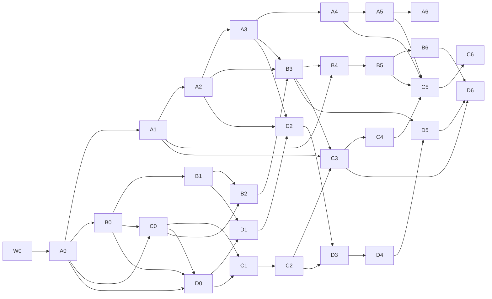

# Shots: execution plan

Four lanes build Shots in five days. Shots prepares MiniMax H3 shot assets for ComfyUI: grey-box
blocking, guide stills, pose and layout control videos, mattes and a structured prompt, packaged per
shot. ConceptStudio doesn't generate video. The package format is the seam through which generation could
be added later ([SHOTS-PLAN.md](../SHOTS-PLAN.md) section 7).

| Document | Read it for |
|---|---|
| [CONTRACTS.md](CONTRACTS.md) | Everything that crosses a lane boundary. Read it before writing code. |
| [LANE-A-CORE.md](LANE-A-CORE.md) | PrevisCore: engine, content, bodies, generators, validation, Blockout import |
| [LANE-B-MEDIA.md](LANE-B-MEDIA.md) | Wiring, then ShotsMedia: look, renderer, video, passes, packages, CLI, prompt |
| [LANE-C-SHELL.md](LANE-C-SHELL.md) | The workspace: store, commands, undo, persistence, lists, timeline, inspectors |
| [LANE-D-VIEWPORT.md](LANE-D-VIEWPORT.md) | The 3D viewport: editor camera, overlays, picking, tools, handles, look-through |
| [scripts/blockout/](../../../scripts/blockout/README.md) | The Blockout reference kit: parity oracle, extractor and the seed evaluator |

## Lanes

| Lane | Seat | Machine | Builds | Difficulty |
|---|---|---|---|---|
| A | Gnomon or Theo | Linux with a Swift 6 toolchain, or a Mac | `PrevisCore`, a standalone package | Easiest: Blockout's output is the oracle, and the seed already matches it |
| B | Claude | Mac | W0 wiring, `ShotsMedia`, `shots-export` | Medium |
| C | Ari | Mac | The Shots workspace in the app | Medium-high: the most surface area |
| D | Metis | Mac | The viewport | Hardest: carries the interaction feel |

The owner confirms where each seat runs. Lanes B, C and D need macOS with Xcode.

**Decisions this plan builds on:**
- **Build now.** The owner chose to build now, with Phase 0 running alongside rather than as a gate.
- **From SHOTS-PLAN section 10, all as recommended:**
  - a separate workspace in the same window;
  - a one-way Blockout importer;
  - the first content set below;
  - creatures later, with full-transform attachments from day one.
- **Package contents.** Clean reference, pose, layout and mattes. Phase 0 shows which matter most. Depth
  is reserved, not built.
- **Provisional choices,** open to change after Phase 0: MP4 rather than PNG sequences, and per-shot sound
  and music notes.
- **For the owner:** PRODUCT.md doesn't describe Shots yet. Lane C proposes a paragraph for the owner to
  approve.

**Milestones:**
- **M1, headless packages** (day 3): `shots-export` turns a Blockout project into a ComfyUI-ready package.
  This is SHOTS-PLAN's milestone A0.
- **M2, Shots in the app** (day 4): block, export and write the prompt inside ConceptStudio. This is
  SHOTS-PLAN's milestone A.

## Schedule

| Day | A (PrevisCore) | B (ShotsMedia) | C (workspace) | D (viewport) |
|---|---|---|---|---|
| 1 | **A0** (once W0 lands), A1, start A2 | **W0** (first hour), B0, B1 | C0, C1, start C2 | D0, D1 |
| 2 | A2, A3 | B2, B3, start B4 | C2, C3 | D1, D2, start D3 |
| 3 | A4, A5 | B4 (**M1**), B5 | C4, start C5 | D3, D4 |
| 4 | A6, support | B6 | C5, C6 (**M2** with D6) | D5, D6 (**M2** with C5, C6) |
| 5 | Owner walkthrough, fixes, signed build | | | |

**What the owner can check at the end of each day:**

| Day | Check |
|---|---|
| 1 | CI is green with the new packages. Render tests draw the sample shot. The Shots workspace opens in a project without concepts and hosts the viewport. The content catalog and Blockout import work. |
| 2 | The parity test passes against Blockout. `swift run shots-export --sample --out <dir>` writes a valid package with guides, pose, layout and mattes. The signed app's `--shots-self-test` passes. Shots edits survive quit and reopen, with undo. Viewport snapshots show posed people, marks and ribbons. |
| 3 | **M1:** `shots-export --blockout <project.json>` produces a ComfyUI-ready package, so Phase 0 can start. Timeline and shot list in the app. Clicking selects, places people and drops marks. |
| 4 | **M2:** the whole loop in the app: block, export, write the prompt. Handles and look-through work. |
| 5 | Walkthrough together, screen by screen; fixes; signed build. |

## Dependencies

An arrow means the later checkpoint needs the earlier one *merged*. Until then, code against the
declarations in CONTRACTS.md. Within a lane the order is the plan, though neighbouring checkpoints often
overlap.

## Starting

1. **Lane B lands W0** (about an hour): the shared build wiring, CI, lint paths and the preview script.
2. **Lane A lands A0** on top of it (2–3 hours). A0 transcribes CONTRACTS section 5, with a few functions
   working for real.
3. Meanwhile, the other lanes read the contracts and their lane document, and draft against the
   declarations.
4. **B0 and C0 land, then D0, then C1.** From there the lanes run in parallel.
5. Each lane keeps `app/docs/shots/status/lane-<a|b|c|d>.md` current at every checkpoint.
6. **Git:** one worktree and branch per lane, one PR per checkpoint, rebase or merge commits (not squash),
   files staged by name (CONTRACTS section 1).

## First content set

A1 writes this to `starter.v1.json`. Everything else stays in the data files, exposed on request.

- **Assets (21):** person.man, person.woman, person.child, person.elderly, animal.horse, animal.dog,
  vehicle.sedan, vehicle.bus, furniture.bed, furniture.couch, furniture.chair, furniture.diningTable,
  furniture.desk, furniture.door, furniture.window, prim.cube, prim.cylinder, prim.wall, prim.stairs,
  prim.ramp, prop.tree.
- **Motions (68):**
  - **Strikes:** jab-cross, jab-hook-cross, hook-punch, uppercut, haymaker, front-kick, side-kick,
    roundhouse-kick, high-kick, spinning-back-kick, spinning-back-fist, knee-strike, elbow-strike,
    low-sweep, teep-push-kick, shove-two-hands, tackle-lunge, boxing-combo.
  - **Defence:** block-high, block-low, parry-deflect, dodge-left, dodge-right, duck-under, weave-bob,
    jump.
  - **Hits and falls:** hit-reaction-head, hit-reaction-body, stagger-back, knockdown-fall, ko-collapse,
    trip-and-fall-flat, get-up-from-ground.
  - **Guard:** boxing-guard-bounce, guard-up-advance.
  - **Weapons:** sword-slash-combo, sword-thrust, sword-parry, shield-brace, shield-block, bow-draw-loose.
  - **Conversation:** argue-point, nod-yes, shake-no, shrug, thinking-chin, point-ahead, beckon-come,
    wave, hands-on-hips, arms-crossed-settle, laugh-double-over, look-around-wary, facepalm, check-watch,
    salute, bow.
  - **Movement and reactions:** sit-down, stand-up, combat-roll, dive-dodge, hard-landing-crouch,
    freefall-flail, blown-back-explosion, fist-pump, big-wave, cheer-jump, leap-gap.
- **Camera moves (20):** slow-push-in, crash-in, creep-in-low, orbit-90-left, orbit-90-right,
  orbit-45-low, arc-and-push, crane-up-reveal, pedestal-up-slow, spiral-in-descend, side-track-left,
  side-track-right, lead-the-subject, lead-follow-front, follow-behind, low-lead-tilt-up, side-dolly-past,
  slow-tilt-reveal, whip-pan, vertigo-dolly-zoom.
- **Action paths (14):** walk-forward, run-forward, jump-forward, walk-up-stairs, door-burst-run,
  horse-gallop-loop, bird-circle-soar, bird-swoop, plane-banked-circle, plane-flyby, plane-takeoff,
  plane-landing, heli-orbit, plane-crash-dive.

Every id above exists in Blockout at `3f2d056`.
