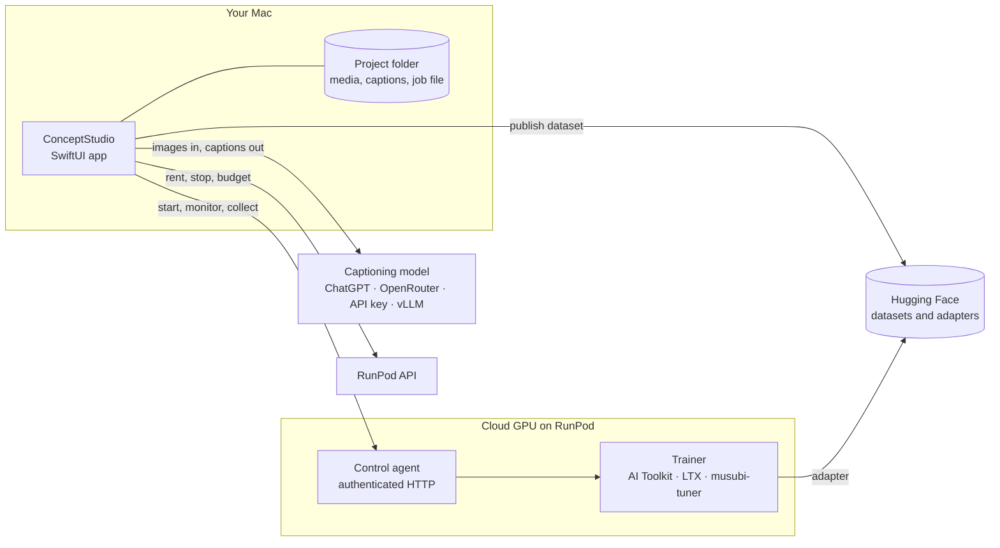

# ConceptStudio engineering

Implementation details and development practices for contributors. For setup, accounts,
GPU costs and operating requirements, see [Running ConceptStudio](../app/docs/RUNNING.md).

## Architecture

- **One model table, read by both sides.** Every supported model is one row of
  [`model-table.json`](../app/Sources/ConceptStudio/Resources/Training/model-table.json). The app
  builds its pickers, defaults and limits from it, and the GPU images carry the same file to
  build the trainer's configuration. Adding a model is a reviewed row plus an image rebuild, not
  new code paths. See [the model table](../docs/model-table.md).
- **Captions shaped for the model being trained.** Caption instructions are an
  [Agent Skills](https://agentskills.io) directory with one *profile* per caption style. Modern
  image models get dense prose, SDXL gets short lines that fit CLIP's limit, and MiniMax H3 gets
  its structured shot fields. Users can supply their own skill. The one hard check is that every
  trigger appears exactly; beyond that, a rerun is the fix.
- **Any captioning model, chosen at run time.** Sign in with a ChatGPT plan, connect
  OpenRouter, use a provider or gateway key, or point at a [vLLM](https://docs.vllm.ai) server
  you run yourself. The app can also start any vLLM-supported model from Hugging Face on the
  cloud GPU and caption with it there. Nothing is tied to one vendor.
- **Cloud GPUs, handled carefully.** Each cloud GPU runs our own container image with a
  small control agent. The app talks to it over a single authenticated HTTP API, and services
  start from a fixed catalogue, never from shell strings. Spending is capped per run and per
  cloud GPU. An idle cloud GPU is stopped, though not while the app is still uploading to it. A
  cloud GPU holding a result that hasn't been saved can't be removed.
- **Stronger defaults where they're measured.** Optional *regularisation* draws reference
  images from the base model itself, captions them with your own captioning model, and mixes
  them in so the base model's sense of the class is preserved.
  [REPA](https://arxiv.org/abs/2410.06940) aligns the model's internal features with a frozen
  DINOv2 encoder for steadier training. Both are on by default for Qwen-Image-2.1.
- **A private, native Mac app.** SwiftUI, sandboxed, with credentials in Keychain and projects
  in ordinary folders you choose. The app starts no subprocesses. Built-in Help explains every
  term in a 178-entry glossary, each in two readings: *Plain language* and *Show me the good
  stuff*.

## Development and verification

- **Every change goes through CI:** the Swift build and tests with strict SwiftLint and
  SwiftFormat; the Python reference package on Python 3.11 to 3.13, with Ruff and `ty` type
  checks; and separate suites for the agent, its command-line client and the trainer
  launchers. Together that is more than 550 Swift tests, about 120 reference tests and close to
  1,000 GPU-side tests. Tool versions are pinned with [mise](https://mise.jdx.dev), and Python
  dependencies are locked with [uv](https://docs.astral.sh/uv/).
- **The GPU side has a fake mode.** The agent runs locally with simulated GPUs, so the whole
  control flow can be tested with no rental and no Docker.
- **Screens are rendered in tests.** An offscreen pass draws every screen in light and dark
  mode at its minimum and default window sizes.
  [`scripts/render-app-preview.sh`](../scripts/render-app-preview.sh) produced the screenshots
  above.
- **Decisions and evidence are written down.** The [decision log](../docs/ADR-LOG.md) keeps each
  product decision verbatim, and the status documents keep source tests, local checks and real
  GPU runs apart. A claim of "works" names the run that showed it.
- **Built with AI coding agents.** Claude Code and Codex built ConceptStudio, working in
  parallel from written briefs. Each change went through independent review and the CI gates
  before merging, and product decisions stayed with the owner. The briefs, reviews and
  walkthroughs are in [`docs/process`](../docs/process/).

